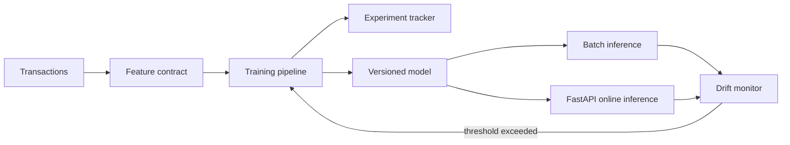

# ModelGuard

An end-to-end fraud-detection platform that keeps training, versioning, online inference, monitoring, and retraining under one tested feature contract.

## Platform flow



## Capabilities

- Deterministic feature engineering shared by training and serving
- Logistic fraud classifier trained without opaque framework state
- PR-AUC and confusion-matrix evaluation
- JSON experiment tracking and content-addressed model versions
- Batch and FastAPI online inference
- Population Stability Index drift alerts
- Reproducible latency and consistency benchmark

## Quickstart

```bash
python -m venv .venv
source .venv/bin/activate
pip install -e '.[dev,api]'
modelguard-train
uvicorn modelguard.api:app --reload
pytest
modelguard-benchmark
```

Measured results are written to `benchmarks/results.json`. The synthetic generator is deterministic, enabling honest CI regression checks without shipping sensitive financial data.

## Measured results

| Metric | Result |
| --- | ---: |
| PR-AUC | 0.7920 |
| Training time | 4.65 s |
| Serving p95 | 0.0023 ms |
| Maximum train-serving delta | 0.0000005 |
| Shifted-population PSI | 1.6282 — detected |

These values come from `modelguard-benchmark` on the deterministic synthetic fraud dataset; the machine-readable report records the exact model version.

## API

`POST /predict` accepts `amount`, `hour`, `velocity_1h`, `international`, and `email_age_days`, then returns the fraud probability, decision, and exact model version.

## Production path

The model and experiment stores use simple JSON adapters for a runnable portfolio demonstration. Their interfaces can be replaced by MLflow/S3 without changing feature, metric, serving, or monitoring behavior.
